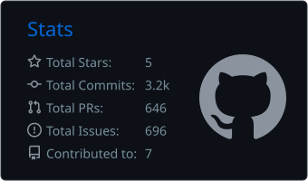
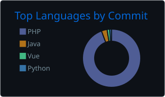

# 💫 About Me:
👋 Hi, I’m @MattYeend 🌱 I’m currently working on more PHP/Laravel/Python 👀 I’m looking to collaborate on anything web, PHP, Laravel, Python, or Java based 🕸️ Visit me <a href="https://mattyeend.co.uk/" target="_blank" rel="nofollow">here</a>

# 💻 Tech Stack:
  
            

# 📊 GitHub Stats:

### 🐟 My Koi

### ✍️ Random Dev Quote

### 🔝 Top Contributed Repositories

<table>
  <tr>
    <td width="50%">
      <b><a href="https://github.com/MattYeend/dashboard">Dashboard</a></b> 
      Laravel and Vue.js CRM-style dashboard. 
      Laravel · Vue.js · MySQL
    </td>
    <td width="50%">
      <b><a href="https://github.com/MattYeend/JavaBasics">JavaBasics</a></b> 
      Java fundamentals and practice exercises. 
      Java
    </td>
  </tr>
  <tr>
    <td width="50%">
      <b><a href="https://github.com/MattYeend/Python">Python</a></b> 
      Python projects and experiments. 
      Python
    </td>
    <td width="50%">
      <b><a href="https://github.com/MattYeend/Java">Java</a></b> 
      Java projects and experiments. 
      Java
    </td>
  </tr>
  <tr>
    <td width="50%">
      <b><a href="https://github.com/MatthewYeend/Python-Best-Practices">Python-Best-Practices</a></b> 
      Python coding standards and best practices. 
      Python
    </td>
    <td width="50%">
      <b><a href="https://github.com/MatthewYeend/Laravel-Best-Practices">Laravel-Best-Practices</a></b> 
      Laravel coding standards and best practices. 
      Laravel · PHP
    </td>
  </tr>
  <tr>
    <td colspan="2">
      <b><a href="https://github.com/MatthewYeend/Java-Best-Practices">Java-Best-Practices</a></b> 
      Java coding standards and best practices. 
      Java
    </td>
  </tr>
</table>

---

  ## 💰 You can help me by Donating
   
  

  
<!-- Proudly created with GPRM ( https://gprm.itsvg.in ) -->
